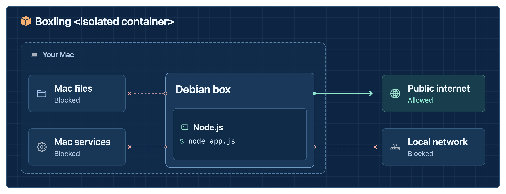
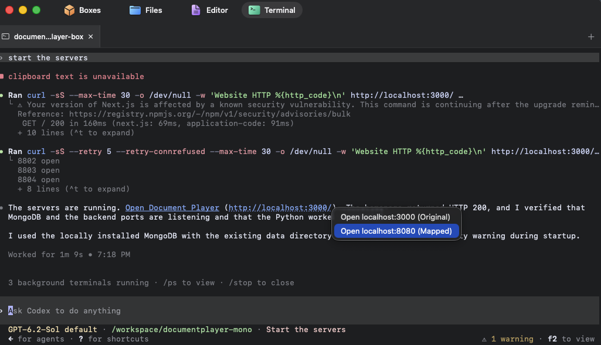
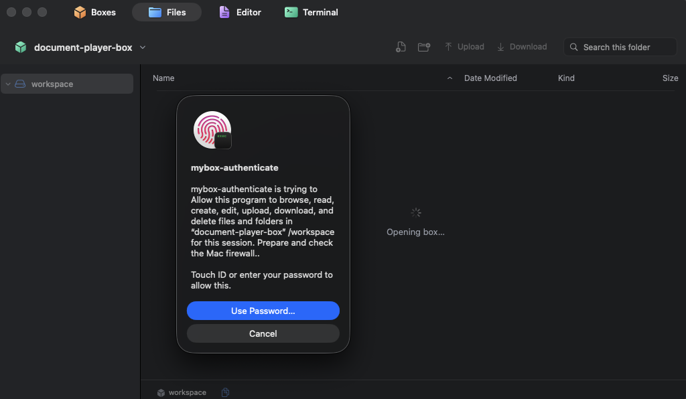
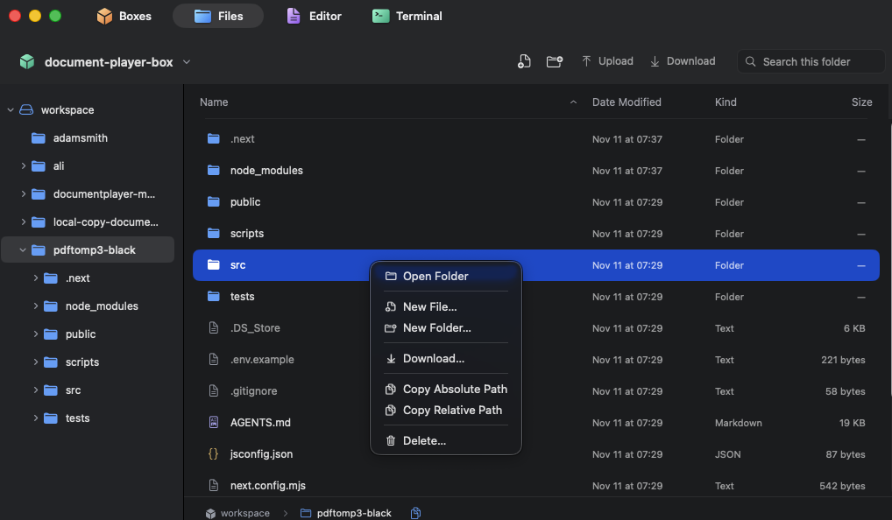

# Boxling

Boxling is an app for running isolated Linux workspaces, built on a fork of Apple's `container`.

- Isolated Debian workspaces on Apple silicon.
- Touch ID or password for shell and file access.
- Access to your Mac’s files, services, and the local network is blocked by default.
- Built-in terminal, file browser, and text editor.

## Example

- Node.js inside a box cannot access files or services on your Mac.
- Apps on your Mac cannot run commands or access files inside the box without your approval.


## Install

[Download Boxling (.pkg)](https://github.com/janpmz/boxling/releases/download/v0.1.2/Boxling-0.1.2-arm64.pkg) · Apple silicon · macOS 26+

## How it works

Apps inside a box are blocked from accessing your Mac and local network.



File transfers and shell access require approval with Touch ID or your password.


Use port mappings to reach an app inside a box.


The virtual disk of each box is protected and owned by a dedicated macOS user. Direct access to the disk by other apps is blocked.


## Screenshots

Click links in the terminal to open them. Click paths in the terminal to open them in the file browser.



To access files in the box, authenticate with Touch ID or your Mac password.



Browse files in the box.



## Commands

[Boxling CLI on GitHub](https://github.com/janpmz/boxling-cli)

```text
$ boxling
Boxling 0.1.2 — a small Linux workspace on your Mac

Usage: boxling <command>

  create <name> [--inside-port N --outside-port N] [--cpus N] [--memory 2g]
                         Create and start a Debian box (default: 2 CPUs, --memory 2g).
                         --inside-port: server port inside the Linux box.
                         --outside-port: localhost port on your Mac.
                         Repeat both flags for multiple TCP port mappings;
                         pair the first inside port with the first outside port.
  enter <name>           Start if needed and open Bash in /workspace.
                         Accept a unique part of a name. Exact names take priority.
                         List matches and stop if the partial name is ambiguous.
  enter <name> -- <command> [arguments...]
                         Run a Linux command; piped input is supported.
  copy <source-name> <new-name>
                         Copy installed tools, settings, and files into a stopped box.
                         Include saved credentials. Keep the source's CPU and memory limits.
                         Use a separate network. Do not copy port mappings or running processes.
  import <name> <host-path> [...]
                         Copy a file or whole folder to /workspace/<source-name>.
                         Select multiple paths with one access approval.
                         Never replace an existing destination.
                         Start the box if it is stopped.
                         Include all file names, including hidden files.
                         Skip symlinks and special files.
  export <name> <box-path> <new-host-path>
                         Copy a file or whole folder out of /workspace.
                         Never replace an existing destination.
                         Start the box if it is stopped.
                         Relative box paths start at /workspace. Reject links.
  start <name>           Start a stopped box, keeping its files.
  stop <name>            Stop a box, keeping its files.
  delete <name> [--yes]  Permanently delete a box and all its files. Stop it first if running.
                         Remove its port mappings and dedicated network. Ask for confirmation.
                         Use the full name; --yes skips confirmation.
  resize [name]          Choose a stopped box and enter CPU, memory, and disk values.
                         Press Enter to keep a value.
  resize <name> [--cpus N] [--memory-gb N] [--disk-size-gb N]
                         Change resources on a stopped box. Keep its files and ports.
                         Enter sizes in GB, using the macOS units for memory and storage.
                         Show available Mac resources before applying changes.
                         Memory: at least 200 MB. Disk: 128 MiB to less than 16 TiB.
                         Disk changes copy the filesystem and need temporary Mac space.
  ports add <name> --inside-port N --outside-port N
                         Add a TCP mapping without restarting a running box.
  ports remove <name> --outside-port N
                         Remove a Boxling mapping without restarting the box.
  ports list <name>      Show saved mappings and forwarding status.
  list [--json]          List boxes created by this CLI, including stopped ones.
                         Show CPU cores, memory, disk use, disk capacity, and ports.
                         --json: structured data with numeric sizes in bytes.
  setup-service          Install the private Boxling account and register its service.
  setup-network          Install the PF helper and automatic Mac startup setup.
  completion zsh         Print the zsh script for Tab completion.
  help                   Show this help.
  --version              Show the Boxling version.

No host folders, project disks, or SSH agents get mounted.
Each box connects to its own virtual network. Boxling checks the firewall rules before starting Linux.
Run setup-service once in a Mac terminal. PF changes require administrator access.
```
