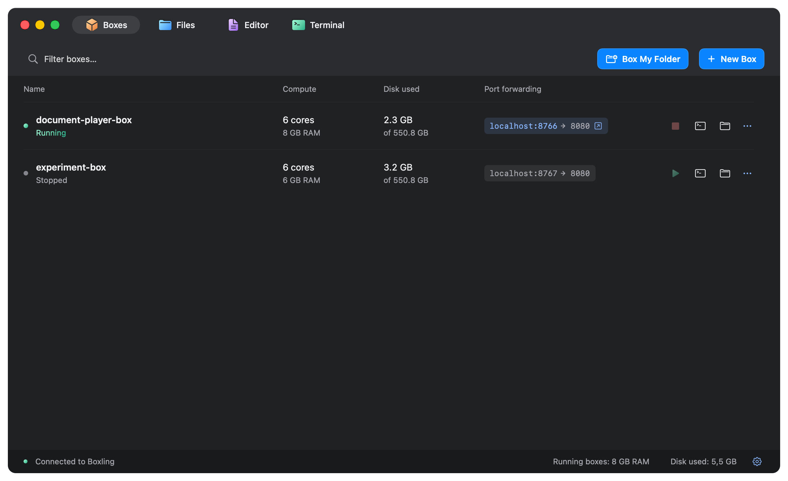

# Boxling

Run apps in isolated Linux workspaces on your Mac.

**Requires Apple silicon and macOS 26 or later.**

[**Desktop downloads**](https://github.com/janpmz/boxling/releases) · [Command-line guide](https://github.com/janpmz/boxling-cli)

The desktop installer will be published on the Releases page.

## Work inside a box

Open a Linux shell in the **Terminal** tab, browse `/workspace` in **Files**, and edit text files in the **Editor** tab. Use **Box My Folder** to copy an existing Mac folder into a new box.

## Control access

Boxling uses macOS approval for shells, commands, and file access. A file-browsing session keeps its approval while the connection is open.

Each box runs on a separate virtual network. When you want to open a web app running in a box, forward its port to `localhost` on your Mac.
